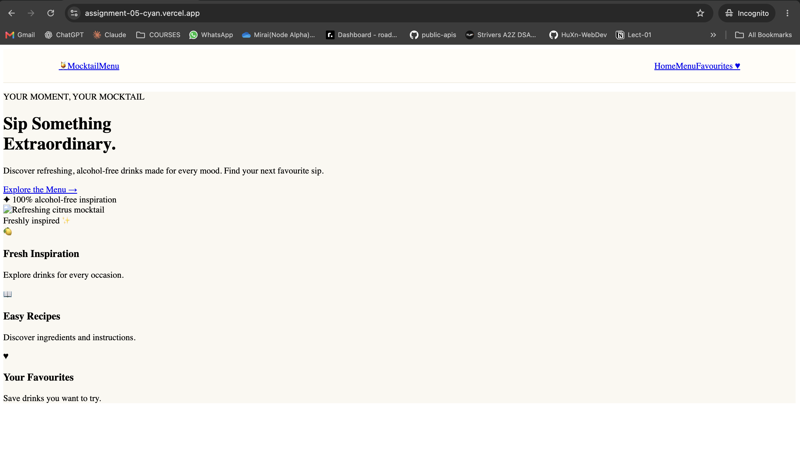

# PS-8: Mocktail Menu

A responsive mocktail discovery app where users can browse alcohol-free
drinks, search the collection, view recipes, and save favourites.

## Project Details

-   **PS Number:** PS-8
-   **Project Name:** Mocktail Menu
-   **Frontend:** React, Vite, CSS
-   **API Used:** [TheCocktailDB
    API](https://www.thecocktaildb.com/api.php)
-   **Live Demo:** <https://assignment-05-cyan.vercel.app/>
-   **GitHub Repository:**
    [devashish10079/Assignment-05](https://github.com/devashish10079/Assignment-05)

## API Endpoints Used

-   **List non-alcoholic drinks:**
    `https://www.thecocktaildb.com/api/json/v1/1/filter.php?a=Non_Alcoholic`
-   **Get a drink's recipe and details:**
    `https://www.thecocktaildb.com/api/json/v1/1/lookup.php?i={id}`

The app uses TheCocktailDB to retrieve the mocktail collection and
individual drink details, including ingredients and instructions.

## Routes

  Route           Description
  --------------- ------------------------------------------------------
  `/`             Home page with an introduction to Mocktail Menu
  `/drinks`       Browse and search the non-alcoholic drink collection
  `/drinks/:id`   View a drink's recipe, ingredients, and instructions
  `/favourites`   View drinks saved as favourites
  `*`             Not-found page for unmatched routes

## Screenshots

### Home Page



### Mocktail Collection


## Run Locally

1.  Clone the repository:

    ``` bash
    git clone https://github.com/devashish10079/Assignment-05.git
    cd Assignment-05
    ```

2.  Install dependencies:

    ``` bash
    npm install
    ```

3.  Start the development server:

    ``` bash
    npm run dev
    ```

4.  Open the local URL printed in your terminal (Vite usually uses
    `http://localhost:5173`).

## Build

``` bash
npm run build
```

## Author

**Devashish** --- [GitHub Profile](https://github.com/devashish10079)
